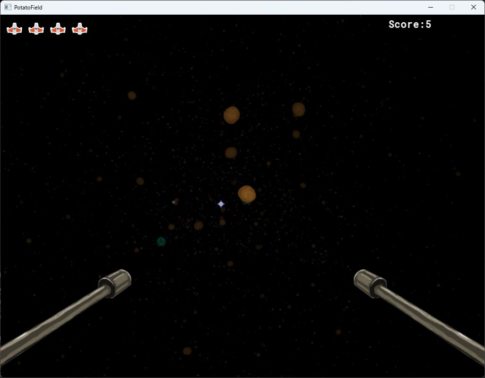

# PotatoField

A small space shooter and my first C++ game, built to learn rendering math and gameplay systems without Unity or Unreal. Objects live in a 3D world; SFML draws their projected 2D sprites.

[](https://www.youtube.com/watch?v=RhFBIFvU53A)

[Download Windows x64 (V1.1)](https://github.com/Harsanyi/PotatoField/releases/download/V1.1/PotatoField-1.1.0-Windows-x64.zip) · [Release notes](https://github.com/Harsanyi/PotatoField/releases/tag/V1.1) · [Gameplay video](https://www.youtube.com/watch?v=RhFBIFvU53A)

## Rendering a 3D space with sprites

The rendering layer is the main experiment:

1. Gameplay objects store `glm::vec3` positions. The nearest repeated position is selected within a wrapping, 10,000-unit cube.
2. An inverse quaternion transforms the relative position into camera space. The camera faces **+Z**, with **+X right** and **+Y down**.
3. A custom perspective projection maps camera-space positions to the SFML viewport. The original projection scale is preserved; its angle parameter is not a calibrated horizontal field of view.
4. Objects are sorted from far to near, scaled and shaded by distance, then written into one shared `sf::VertexArray` of textured quads. Sprites behind the camera or inside the near cutoff are hidden.
5. A separate vertex array draws 10,000 distant stars using camera rotation.

SFML provides the window, 2D drawing and audio. The project implements camera transforms, projection, wrapping, render order, sphere-overlap checks, shooting, enemies, pickups, menus and score updates directly in C++17.

The core is in [WorldMath.h](src/WorldMath.h), [Graphics.cpp](src/Graphics.cpp), [Player.cpp](src/Player.cpp) and [Star.cpp](src/Star.cpp). Gameplay updates, camera shake and effect lifetimes run on the main thread. World objects belong to the `Graphics` registry and are deleted through a deferred destruction queue; UI and audio resources have scoped owners. Events return subscription IDs and allow safe changes during dispatch.

## Play

Destroy enemies to score points. Each defeated enemy creates two replacements and may drop a health pickup.

| Input | Action |
| --- | --- |
| Mouse | Look around |
| W / S | Accelerate forward / backward |
| A / D | Accelerate left / right |
| E / Q | Accelerate up / down |
| Left click | Fire, alternating weapons |
| Escape | Exit |

Movement has inertia: releasing a movement key does not stop the player. Click **Start** in the menu; after defeat, click **Game Over** to return to it.

## Build on Windows

Requires a C++17 compiler, CMake 3.28 or newer and the Visual Studio **Desktop development with C++** workload. The first configure downloads pinned, SHA-256-checked archives of **SFML 2.6.2** and **GLM 1.0.1**.

```powershell
git clone https://github.com/Harsanyi/PotatoField.git
cd PotatoField
cmake -S . -B build
cmake --build build --config Release --parallel
.\build\bin\Release\PotatoField.exe
```

For an explicitly selected Visual Studio 2022 generator, configure with `cmake -S . -B build -G "Visual Studio 17 2022" -A x64` instead. The verified toolchain is Windows x64, Visual Studio 2026 / MSVC 14.50 and CMake 4.2.1. Other platforms have not been tested.

CMake copies `assets/` and `openal32.dll` beside the executable. Assets are resolved relative to the executable, so launching from another working directory is supported. Keep these files together when moving a build.

## Checks and packaging

```powershell
ctest --test-dir build -C Release --output-on-failure
cpack --config build/CPackConfig.cmake -C Release -B dist
```

The tests cover event removal and mutation during dispatch, quaternion transforms, world wrapping, hits and score, effect expiry, visual-only shake, pickups, damage, game states, frame-rate-independent movement, near/behind-camera rendering and shutdown. The runtime check opens a hidden SFML window and needs a graphics-capable desktop and audio backend.

For MSVC AddressSanitizer, use a separate build from an x64 Visual Studio developer shell:

```powershell
cmake -S . -B build-asan -DPOTATOFIELD_SANITIZE=ON
cmake --build build-asan --config RelWithDebInfo --parallel
ctest --test-dir build-asan -C RelWithDebInfo --output-on-failure
```

This instruments the project's runtime code; SFML and its external binaries remain uninstrumented. MSVC's sanitizer checks memory access errors, not memory leaks. The sanitizer runtime must be on `PATH` (provided by the developer shell).

The ZIP package includes the executable, assets, OpenAL DLL and third-party notices/source archive. The original [V1.0 release](https://github.com/Harsanyi/PotatoField/releases/tag/V1.0) is preserved as a historical build.

## Scope and limitations

This remains an early learning project: a fixed 1024 × 768 viewport, billboard sprites with painter's-order overlap, simple sphere collisions and a small registry of world objects. Movement and timers use elapsed frame time, capped at 50 ms after a long stall. It is a playable rendering experiment, with no general-purpose engine architecture or mesh renderer.

## License

The project's source code is under the [MIT license](LICENSE). Media and libraries have separate terms; see [third-party notices](THIRD_PARTY_NOTICES.md). The external game media is retained with the author's confirmation of distribution rights and no required attribution.
